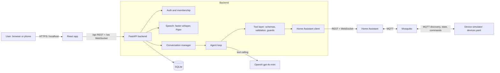
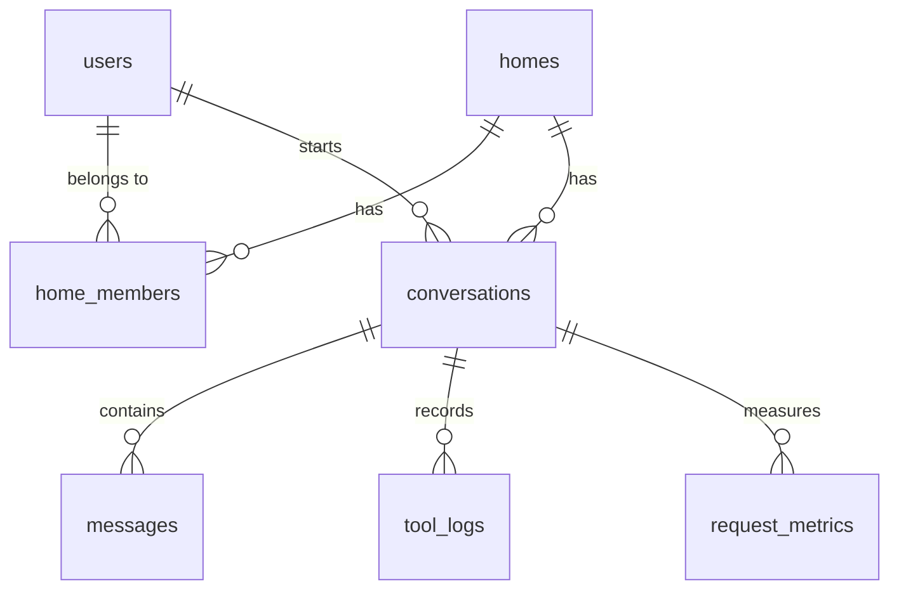

# AI Home Assistant POC: Plan

| | |
|---|---|
| **Status** | Agreed |
| **Date** | 2026-11-17 |
| **Author** | Arooj Fatima |
| **Based on** | `docs/brainstorm.md`, `../PRD.md`, `../ARCHITECTURE.md`, `../PROJECT_PLAN.md` |

This plan summarises the agreed technical and delivery plan. The PRD and ARCHITECTURE documents stay the detailed source; this file adds the brainstorm decisions (Should and Could items, test server, trainer feedback).

---

## Tech stack

| Area | Choice | Reason |
|---|---|---|
| Backend | Python 3.12, FastAPI, Uvicorn, Pydantic | Async, built-in WebSocket, automatic API docs, best Python ecosystem for AI |
| LLM | OpenAI gpt-4o-mini, Chat Completions with tools (`openai` SDK) | Key available; reliable tool calling; low cost. Model name in `.env` |
| Agent | Hand-written loop | Learning the loop is the goal (no LangChain, Agents SDK or HA MCP) |
| Database | SQLite (`sqlite3`, WAL mode), numbered SQL migrations at startup | One file, no server |
| Auth | `pwdlib[argon2]`, `PyJWT` (HS256) in an `httpOnly` cookie | Standard FastAPI approach; page scripts can't read the token |
| Secret encryption | `cryptography` (Fernet) | HA tokens encrypted at rest |
| HA client | `httpx` (REST), `websockets` (live events, registries) | Async, standard |
| Smart home | Home Assistant (Docker), Mosquitto (Docker) | Industry-standard hub; MQTT discovery |
| Virtual devices | Python simulator with `aiomqtt`, devices in `devices.yaml` | Teaches MQTT; limits and faults configurable; no hardware needed (trainer agreed) |
| Speech | `faster-whisper` (`base`, CPU, int8), Piper (`piper1-gpl`) | Free, local, private |
| Frontend | React 19, Vite, TypeScript | Common, fast setup |
| Run | Docker Compose | One command starts everything |
| Tests | `pytest` (async), evaluation script `tests/run_eval.py` | Unit and API tests mock OpenAI and HA; evaluation uses the real LLM and stack |

Versions are pinned exactly in `requirements*.txt` and `package-lock.json`.

---

## Architecture

"Our app is the AI brain, Home Assistant is the hands."

Rules that apply everywhere:

1. **The LLM decides, code acts.** Validation, membership checks and device commands are in our code.
2. **Home Assistant is the source of truth for devices.** No device, room or state tables.
3. **Nothing hard-coded.** Tool schemas and the home snapshot are built from HA data on every request.
4. **Every request is scoped to a home.** Membership is checked on every route, the WebSocket and every tool call.
5. **Real device control.** Success is reported only after HA confirms the new state (3-second timeout). A success message without a confirmed change is not allowed (trainer feedback).
6. **Measure everything.** Tool calls, tokens and per-stage latency are logged.

---

## Data model

SQLite, 7 tables. Rooms and devices are read from Home Assistant, not stored.

| Table | Fields | Notes |
|---|---|---|
| `users` | `id`, `name`, `email` (unique), `password_hash`, `created_at` | Argon2 hash; never logged |
| `homes` | `id`, `name`, `city`, `country`, `timezone`, `ha_url`, `ha_token_encrypted`, `created_at` | Token Fernet-encrypted; never sent to the browser |
| `home_members` | `user_id`, `home_id`, `joined_at` | Equal access for all members; `ON DELETE CASCADE` |
| `conversations` | `id`, `user_id`, `home_id`, `title`, `created_at` | `ON DELETE CASCADE` from homes |
| `messages` | `id`, `conversation_id`, `turn_no`, `role`, `content`, `tool_calls_json`, `tool_call_id`, `created_at` | `turn_no` groups whole turns for the 10-turn window |
| `tool_logs` | `id`, `conversation_id`, `turn_no`, `tool_name`, `arguments_json`, `result_json`, `duration_ms`, `created_at` | Every tool call |
| `request_metrics` | `id`, `conversation_id`, `turn_no`, `input_mode`, `stt_ms`, `llm_ms`, `device_ms`, `tts_ms`, `total_ms`, `input_tokens`, `output_tokens`, `model` | Latency and tokens for the report |

The Could item "manage rooms" uses HA's WebSocket API and adds no tables.

---

## Milestones

Each milestone ends with a Friday demo and written sign-off by the team lead.

| Milestone | Date | What the user can see and test | Scenarios |
|---|---|---|---|
| **M1** Home connected | 2026-11-20 | The 11 virtual devices appear in HA. A user signs up, logs in, creates a home, connects it to HA (test connection), sees the devices from the app and switches one on through HA. Request to IT for test server access is sent. | Spike: one gpt-4o-mini tool call from a script |
| **M2** AI assistant (text) | 2026-11-27 | Text commands control devices through tool calling; follow-ups, corrections, status questions, clarification, bulk confirmation, unknown device, offline device and partial failures work; conversations stored; tool, token and latency logs. Members API. | T1 to T16, T18 to T24 |
| **M3** Full demo (text and voice) | 2026-12-04 | Web app: sign-up, login, home switcher, home setup (connect HA, add members), chat with conversation list, live dashboard, push-to-talk, spoken replies with mute; per-stage latency. | T17 |
| **M4** POC delivered | 2026-12-11 | Day 1: deploy to the internal BrainX test server (HTTPS, BrainX network or VPN only) and test push-to-talk on a phone. Full evaluation and fixes, statistics, code and dependency review, README, report, demo. If time is left: room management in the app, Matter virtual light. | T1 to T24 |

Priorities if time runs short (from the brainstorm):

- **Should** (simplify first): add and remove members, several homes and switcher, delete a home, past conversations list, full device controls on the dashboard, test server deployment.
- **Could** (only if time is left, M4): room management through HA's WebSocket API (2 to 3 days), Matter virtual light.

---

## Technical risks

| Risk | Impact | Mitigation |
|---|---|---|
| HA details: MQTT discovery fields, registries, matching `state_changed` to a command | 1 to 2 days of trial and error in M1 | Start with one device type; check current HA docs; integration tests against the Compose stack |
| gpt-4o-mini accuracy on follow-ups, bulk "yes" (T10), implicit intent (T14), corrections (T23) | Pass rate likely 85 to 95% | Typed strict schemas, clear prompt, validation in code, low temperature, fix time in Sprint 4 |
| Latency: two LLM calls plus HA confirmation; CPU Whisper in Docker | Text about 1.5 to 3 s, voice about 3 to 5 s | Whisper `base`; measure each stage; report real numbers |
| HA first-time setup is manual (admin, MQTT integration, token) | Blocks automated tests | Setup checklist in README; `scripts/load_demo_data.py` |
| Apple M1 with 16 GB RAM | Slow if Docker is starved | Give Docker about 8 GB |
| Test server holds the OpenAI key and HA tokens | Security exposure (ISO 27001) | IT approval, HTTPS, BrainX network or VPN only, secrets outside Git |
| Browser microphone needs HTTPS or localhost | Push-to-talk fails on phones over plain HTTP | Test server uses HTTPS |
| Docker Desktop licence for company use | Legal only | IT to confirm; fallback Colima with the same Compose file |
| Piper is GPL-3.0 | Problem only if reused in a client product | TTS behind one small interface |
| gpt-4o-mini shutdown on 2027-01-14 | None for the POC | Model name in `.env` |

---

## Decisions log

| # | Decision | Reason |
|---|---|---|
| D1 | Home Assistant from day one | HA already manages rooms, devices and states; matches real smart homes |
| D2 | Virtual devices from our own MQTT simulator | Teaches MQTT and discovery; limits and faults configurable; trainer agreed to virtual devices |
| D3 | Rooms and devices read from HA, not stored | Less to build; one source of truth |
| D4 | Hand-written agent loop | Learning goal is the loop |
| D5 | Our own tools, not HA's MCP server | Learning goal is tool design |
| D6 | Typed tools per device type | Clearer schemas help a small model |
| D7 | Success only after HA confirms the state | Real device control (trainer feedback); enables offline, timeout and partial-failure handling |
| D8 | SQLite | Persistent, zero setup |
| D9 | Local speech to text and text to speech | Free, private |
| D10 | JWT in an `httpOnly` cookie | Not readable by page scripts |
| D11 | Equal access for members, no roles | Simpler for a POC |
| D12 | Matter optional | Keeps the POC small |
| D13 | No real hardware | No purchase; the developer's Haier fridge (HaiSmart) and Orient AC (remote only) can't connect to HA without unofficial add-ons or new hardware |
| D14 | Test server deployment on day 1 of Sprint 4; IT access requested in Sprint 1 | Voice is done by then; leaves time to fix phone issues; approvals take time |
| D15 | Room management is a Could item, through HA's WebSocket API | 2 to 3 days; HA stays the source of truth |
| D16 | Trainer feedback added as T23 (correction follow-up) and T24 (status values), and explicit wording in FR-12 | Makes real control, status queries and context explicit acceptance tests |
| D17 | Sign-up also logs the user in | One step less for a new user (decided in use-case review) |
| D18 | On/off endpoint per device (`POST .../devices/{entity_id}/turn_on`, `/turn_off`), using the same HA client and confirmation as the tools | Lets M1 be tested by hand in Swagger; the M3 dashboard reuses it for on/off buttons. Other settings (brightness, temperature) stay assistant-only, unless D19 is built |
| D19 | Full dashboard controls (brightness, AC temperature, mode, fan, fan speed) are a Should item in M3, through one `command` endpoint that reuses the tool layer validation and confirmation | Users can tap or ask; no duplicated logic; Sprint 3 stays safe if voice takes longer |
| D20 | Conversations are private per user; past conversations are read-only; messages up to 1000 characters; voice up to 30 s; bulk confirmation only in the next message; mute saved per browser; light mode only | Decided in use-case review |
